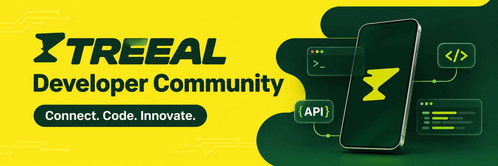

<div align="center">


# TREEAL Developer Community

### Connect. Code. Innovate.

**Building the future of financial technology.**

[](https://treeal.com)


</div>

---

## 👋 Hello, Developers!

Bem-vindo à **Treeal Developer Community**, um espaço para conectar pessoas apaixonadas por programação, tecnologia e inovação financeira.

A Treeal oferece infraestrutura financeira para empresas, com soluções integradas de pagamentos, serviços bancários e identidade digital, orientadas à performance, escala e controle operacional.

Queremos aproximar desenvolvedores, arquitetos de software, engenheiros e entusiastas da tecnologia para compartilhar conhecimento e explorar novas possibilidades no mercado financeiro.

## 🚀 Nosso ecossistema

| Solução | O que possibilita |
| :--- | :--- |
| ⚡ **API Pix** | Integração de pagamentos instantâneos em aplicações e plataformas. |
| 🏦 **Banking as a Service (BaaS)** | Serviços financeiros e contas digitais com a identidade da empresa. |
| 🔗 **Open Finance** | Jornadas financeiras conectadas mediante consentimento. |
| 🔄 **Pix Recorrente** | Automação de cobranças periódicas. |
| 🖐️ **PalmBio by Treeal** | Biometria palmar para identidade, acesso e pagamentos sem contato. |
| 💳 **UnionPay** | Soluções de emissão de cartões com alcance internacional. |
| 🛒 **Subadquirência** | Integração de pagamentos por cartão e Pix. |
| 📦 **CIOT** | Emissão do Código Identificador da Operação de Transporte. |
| 🌐 **Infoprodutos e Checkout** | Soluções para vendas digitais e jornadas de pagamento. |
| 💰 **ParcelaÊ** | Soluções de parcelamento via Pix. |

Conheça os produtos no [site oficial da Treeal](https://treeal.com).

## 💻 Developer Hub

Nossa proposta é construir um ponto de encontro para explorar:

- **APIs & Integrations** — integração entre sistemas e serviços financeiros.
- **SDKs & Libraries** — ferramentas e bibliotecas para desenvolvimento.
- **Code Samples** — exemplos práticos e referências de implementação.
- **Technical Documentation** — guias e conhecimento técnico.
- **Labs & Innovation** — experimentação, protótipos e novas ideias.
- **Security & Compliance** — boas práticas de segurança e privacidade.

Os materiais serão disponibilizados nos repositórios da comunidade conforme sua publicação.

## 🤝 Let's build together!

Acreditamos que a inovação acontece quando pessoas compartilham conhecimento, experiências e ideias.

- Explore os repositórios da organização.
- Compartilhe ideias e experiências técnicas.
- Participe das discussões quando habilitadas.
- Sugira melhorias e contribua com os projetos conforme suas diretrizes.

Nunca publique credenciais, tokens, chaves de API ou dados financeiros reais nos repositórios, issues ou exemplos de código.

## 🌐 Connect with Treeal

- [Website oficial](https://treeal.com)
- [Instagram](https://instagram.com/treealoficial)

---

<div align="center">

```text
$ treeal init --community
> Connecting developers...
> Loading financial technologies...
> Ready to build the future!
```

**Built for developers. Powered by Treeal.**

💚 TREEAL Developer Community

</div>
